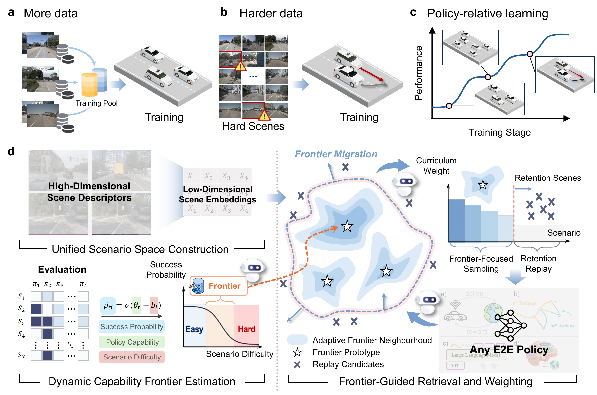
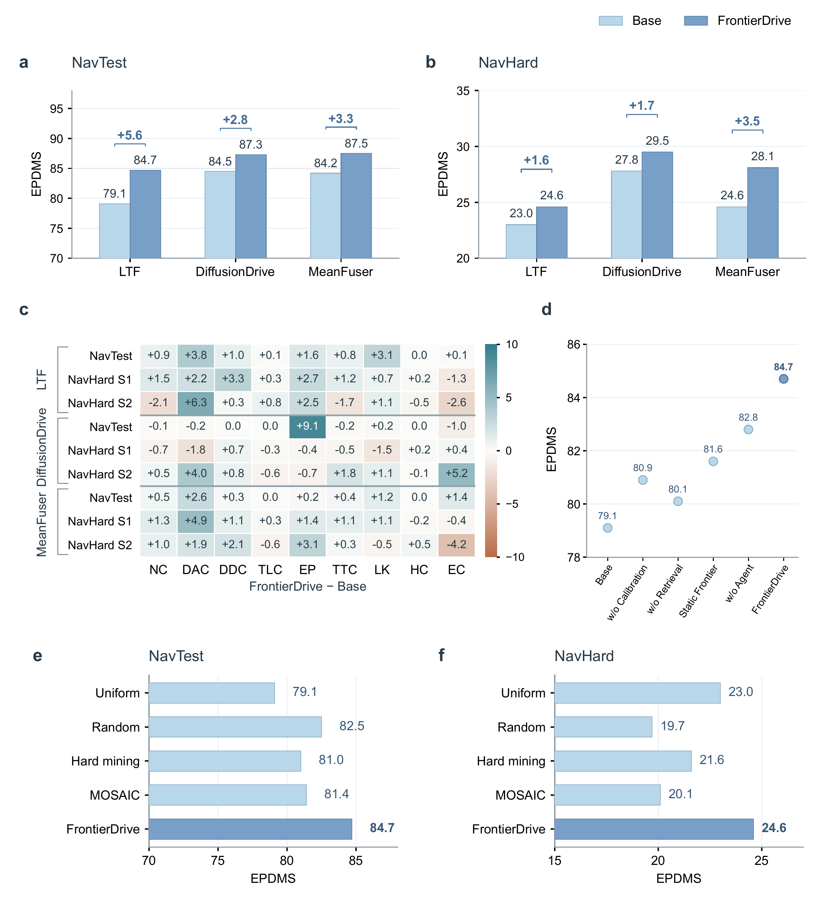
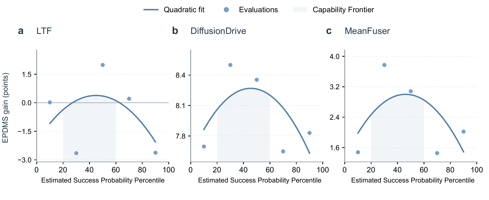
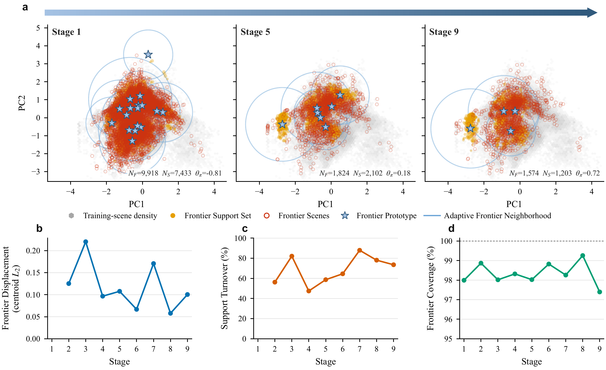
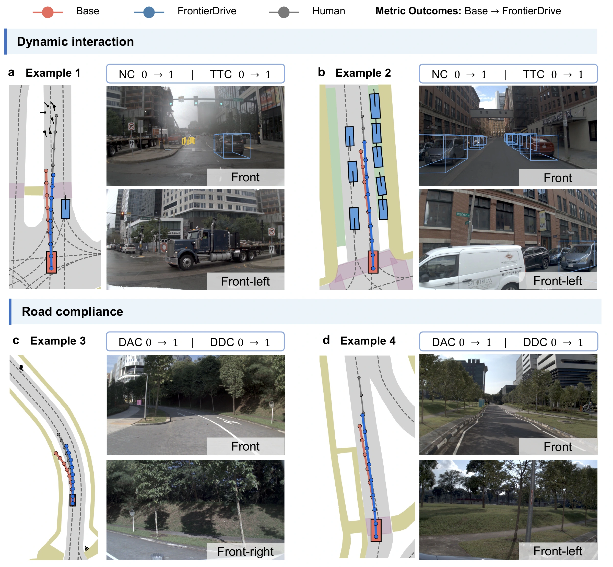
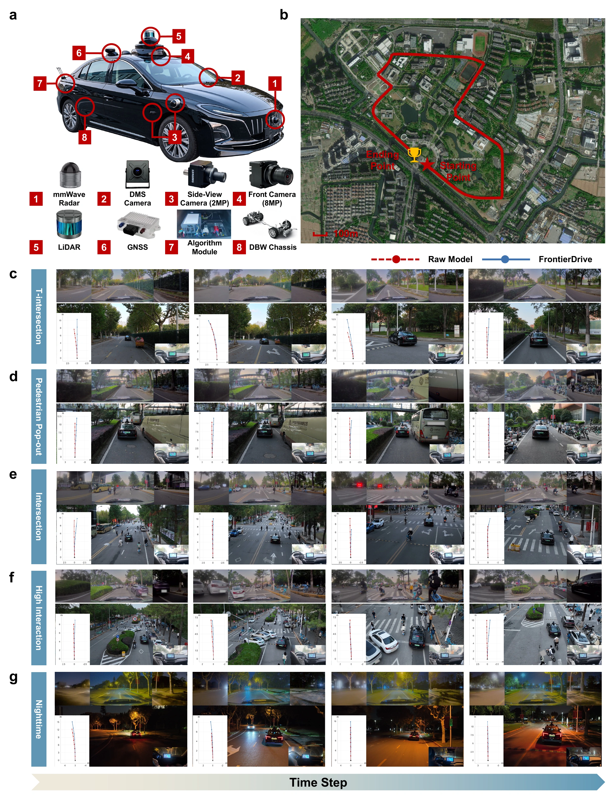

<div align="center">

# 🚘 FrontierDrive

### Self-learning at the frontier of competence in autonomous driving

**Learn where the policy is ready to improve.**

Yicheng Guo, Chengkai Xu, Zhoudong Yan, Cheng Qin, Hai Lin, Shiyu Fang, Peng Hang, Jian Sun

**Tongji University**

[🌐 Project Page](https://cccc1dhcgd.github.io/FrontierDrive/) &middot; [💻 Code](https://github.com/CCCC1dhcgd/FrontierDrive) &middot; [📚 Citation](#citation)

[Overview](#overview) &middot; [How It Works](#how-it-works) &middot; [Results](#results) &middot; [Real-World Driving](#real-world-driving) &middot; [Quick Start](#quick-start) &middot; [Code](#code) &middot; [Citation](#citation)

</div>

**FrontierDrive** turns the evolving capability of a driving policy into its next training curriculum. It identifies scenarios that are challenging and learnable for the current policy, retrieves related training experiences, and adapts the curriculum as the policy improves. Capability estimation, frontier retrieval, and agent-guided decisions form a closed learning loop that continually answers **what to learn next**.

<p align="center">
  <a href="assest/framework.png"></a>
</p>

<p align="center"><b>Evaluate the policy &rarr; Locate its frontier &rarr; Retrieve useful experience &rarr; Adapt the curriculum &rarr; Learn again</b></p>

<a id="overview"></a>

## ✨ Overview

The value of a driving scene changes with the learner. FrontierDrive makes this relationship the organizing principle of autonomous improvement.

- 🎯 **A learner-relative principle.** Across regression, diffusion, and flow-matching planners, the strongest learning gains concentrate in an intermediate region of estimated success probability. The frontier identifies experience that the policy is ready to learn from.
- 🔄 **A frontier that moves.** Sequential evaluations separate policy capability from scenario difficulty. Every policy update relocates the frontier and redirects the training focus.
- 🗺️ **A curriculum grounded in driving scenes.** A shared scenario space connects frontier observations to related training examples. Adaptive neighborhoods and retention replay turn that connection into a weighted sampling distribution.
- 🤖 **An agent-orchestrated learning loop.** Four complementary roles combine current capability evidence with cross-stage memory to analyze progress, map the frontier, plan the curriculum, and verify the next update.

<a id="how-it-works"></a>

## 🧭 How It Works

### From capability evidence to training experience

1. **Represent the driving world.** Encode route geometry, surrounding traffic, ego motion, and interactions with **21 scene descriptors**. A training-fitted, whitened PCA projection creates a shared **12-dimensional scenario space**.
2. **Estimate policy capability.** Accumulate scene-level evaluation responses across stages. A regularized Rasch model estimates policy capability and scene difficulty, yielding a success probability for each policy-scene pair.
3. **Locate and retrieve the frontier.** Identify scenes within the current frontier interval, form regional prototypes, and retrieve structurally related training scenes through adaptive neighborhoods.
4. **Allocate the next curriculum.** Combine frontier-focused sampling with retention replay. Adjust the frontier share and regional allocation using current evidence and the history of previous updates.
5. **Update, evaluate, and repeat.** Train with the new sampling distribution, record the resulting outcomes, and use the updated evidence to construct the next frontier.

The two quantities at the heart of the loop are:

$$
p_t(i)=\sigma(\theta_t-\beta_i),
\qquad
q_t(j)=\alpha_t q_t^{F}(j)+(1-\alpha_t)q_t^{R}(j).
$$

Here, $\theta_t$ is the current policy capability, $\beta_i$ is scene difficulty, and $\alpha_t$ allocates training effort between frontier experience and retention replay. A development split supplies capability evidence, the training split supplies policy updates, and the held-out split measures generalization.

### Four roles, one evolving curriculum

| Role | Contribution to the next update |
| --- | --- |
| **Capability Analyst** | Summarizes policy capability, learning progress, and recurring challenges. |
| **Frontier Mapper** | Organizes frontier regions, coverage, and available training support. |
| **Curriculum Planner** | Allocates the training budget between frontier regions and retention replay. |
| **Curriculum Verifier** | Checks the proposed allocation against the data, sampling, and training constraints. |

The [execution harness](frontierdrive/execution_harness.py) turns verified decisions into curriculum manifests and training inputs. [Cross-stage memory](frontierdrive/learning_memory.py) connects applied curricula, capability estimates, and evaluation outcomes across successive updates.

<a id="results"></a>

## 📊 Results

### Better performance across three planner families

FrontierDrive improves all three planners on **NavTest** and **NavHard** under matched initialization and training budgets within each planner. Scores below are **EPDMS** (Extended Predictive Driver Model Score); Base uses uniform scene sampling.

| Planner | Formulation | NavTest: Base &rarr; FrontierDrive | Gain | NavHard: Base &rarr; FrontierDrive | Gain |
| --- | --- | ---: | ---: | ---: | ---: |
| **LTF** | Regression | 79.1 &rarr; **84.7** | **+5.6** | 23.0 &rarr; **24.6** | **+1.6** |
| **DiffusionDrive** | Diffusion | 84.5 &rarr; **87.3** | **+2.8** | 27.8 &rarr; **29.5** | **+1.7** |
| **MeanFuser** | Flow matching | 84.2 &rarr; **87.5** | **+3.3** | 24.6 &rarr; **28.1** | **+3.5** |

In the LTF scene-allocation comparison, FrontierDrive leads **Uniform, Random, Hard mining, and MOSAIC** on both evaluation sets, reaching **84.7 on NavTest** and **24.6 on NavHard**.

<details>
<summary><b>Explore the full results, driving metrics, and component study</b></summary>

<p align="center">
  <a href="assest/planner-performance.png"></a>
</p>

The complete framework reaches **84.7 EPDMS** in the LTF component study. Dynamic capability estimation, moving-frontier retrieval, and agent-guided allocation work together to improve the policy.

</details>

### The most valuable experience lies near the frontier

Learning gains peak in the **20th-60th percentiles of estimated success probability** across all three planner families. Each percentile bin supplies related training scenes for an independent ten-epoch update.

<p align="center">
  <a href="assest/capability-frontier.png"></a>
</p>

This experiment connects **what the policy can currently solve** to **where its next learning gains are concentrated**.

### As capability grows, the frontier moves

Across **nine curriculum stages**, DiffusionDrive's estimated capability rises from **-0.81 &rarr; 0.18 &rarr; 0.72** at Stages 1, 5, and 9. The frontier and its retrieved training support relocate with the learner, while frontier coverage stays **above 97% at every stage**.

<p align="center">
  <a href="assest/frontier-migration.png"></a>
</p>

The largest stage-to-stage support turnover exceeds **85%**, showing how successive updates draw on new regions of training experience. The figure projects the shared scenario space onto its first two principal components; retrieval operates in the full 12-dimensional representation.

<a id="real-world-driving"></a>

## 🌍 From Better Trajectories to Real-World Driving

Frontier-guided updates improve local trajectory choices in dynamic interactions and road-compliance scenarios. The paper's four NavTest examples show improved collision and time-to-collision outcomes, as well as stronger drivable-area and driving-direction compliance.

<details>
<summary><b>See the trajectory-level changes</b></summary>

<p align="center">
  <a href="assest/driving-behavior.webp"></a>
</p>

**Blue:** FrontierDrive &middot; **Red:** Base &middot; **Grey:** recorded human trajectories.

</details>

The FrontierDrive-trained **MeanFuser** policy was deployed directly on an experimental vehicle for a campus driving circuit in Shanghai. The route brings together junctions, pedestrians, non-motorized traffic, constrained road space, and nighttime conditions.

<p align="center">
  <a href="assest/real-vehicle.webp"></a>
</p>

The sequences show FrontierDrive controlling the vehicle through these interactions. Baseline trajectory comparisons are generated offline from the same recorded sensor inputs.

<a id="quick-start"></a>

## 🚀 Quick Start

### Build your first frontier curriculum

Use **Python 3.9+** and run the following in a Bash shell:

```bash
git clone https://github.com/CCCC1dhcgd/FrontierDrive.git
cd FrontierDrive

python -m venv .venv
source .venv/bin/activate
python -m pip install -e .

python examples/synthetic_demo.py --output-dir outputs/first-frontier
```

For Windows PowerShell, activate the environment with `.\.venv\Scripts\Activate.ps1`.

The **CPU-ready synthetic walkthrough** runs feature alignment, capability estimation, and frontier retrieval with **600 training scenes, 120 evaluation scenes, and three evaluation rounds**. It produces a normalized curriculum with a **50% frontier / 50% replay** allocation. Choose a fresh output directory for each run.

Explore the generated stage:

```text
outputs/first-frontier/run/evaluate/stage3/
|-- eval/
|   `-- eval_summary.json
|-- boundary/
|   |-- boundary_summary.json
|   `-- navtest_boundary_selected.csv
`-- retrieval/
    |-- sphere_summary.json
    |-- selected_train_tokens.txt
    `-- train_manifest.csv
```

The manifest connects each scene's `token` to its frontier membership (`selected`), region (`nearest_cluster`), and sampling probability (`train_weight`).

### Bring FrontierDrive to your planner

Install the sampler in your **NAVSIM/SimScale planner environment**:

```bash
python -m pip install -e ".[sampler]"
```

| Planner | Training adapter |
| --- | --- |
| LTF / TransFuser | [train_ltf.py](frontierdrive/integrations/navsim/train_ltf.py) |
| DiffusionDrive | [train_diffusiondrive.py](frontierdrive/integrations/navsim/train_diffusiondrive.py) |
| MeanFuser | [train_meanfuser.py](frontierdrive/integrations/navsim/train_meanfuser.py) |

Each adapter connects the planner's datasets, caches, and checkpoint to the curriculum sampler. Supply the manifest through `+tbat_manifest_path=/path/to/curriculum_manifest.csv`; set the per-epoch draw budget, frontier rotation, and random seed through `tbat_epoch_size`, `tbat_rotation_fraction`, and `tbat_sampler_seed`.

For agent-guided curriculum preparation, configure the environment variables in [.env.example](.env.example), then use [prepare_stage.sh](scripts/prepare_stage.sh) with your aligned scene features, evaluation history, and previous checkpoint. It produces the next stage's **curriculum manifest, verified plan, and training proposal**. Pass these artifacts to the planner adapter and record the update through the execution harness to continue the learning loop.

<a id="code"></a>

## 🧩 Code

| Component | Entry point | What it provides |
| --- | --- | --- |
| Scenario representation | [Feature extraction](frontierdrive/features/extract.py) &middot; [Alignment](frontierdrive/features/align.py) | Scene descriptors and a shared PCA space |
| Capability estimation | [capability_frontier.py](frontierdrive/capability_frontier.py) | Policy capability, scene difficulty, success probabilities, and frontier scenes |
| Adaptive retrieval | [frontier_retrieval.py](frontierdrive/frontier_retrieval.py) | Frontier regions, training support, and weighted manifests |
| Curriculum control | [curriculum_controller.py](frontierdrive/curriculum_controller.py) | Capability analysis, frontier mapping, curriculum planning, and verification |
| Training and replay | [curriculum_sampler.py](frontierdrive/curriculum_sampler.py) | Weighted draws, retention replay, and frontier-support rotation |
| Execution and memory | [Execution harness](frontierdrive/execution_harness.py) &middot; [Learning memory](frontierdrive/learning_memory.py) | Applied curricula, execution records, and cross-stage evidence |
| Evaluation and inspection | [Evaluation summary](frontierdrive/evaluation_summary.py) &middot; [Visualization](frontierdrive/visualization.py) | Stage summaries and frontier-retrieval figures |

All six paper figures used in this README are organized in [assest/](assest), with their source mapping in the [figure guide](assest/README.md).

<a id="citation"></a>

## 📚 Citation

If FrontierDrive contributes to your research, please cite:

```bibtex
@misc{guo2026frontierdrive,
  title  = {Self-learning at the frontier of competence in autonomous driving},
  author = {Guo, Yicheng and Xu, Chengkai and Yan, Zhoudong and Qin, Cheng
            and Lin, Hai and Fang, Shiyu and Hang, Peng and Sun, Jian},
  year   = {2026},
  url    = {https://github.com/CCCC1dhcgd/FrontierDrive}
}
```

## 📄 License

FrontierDrive is released under the [Apache-2.0 License](LICENSE).
